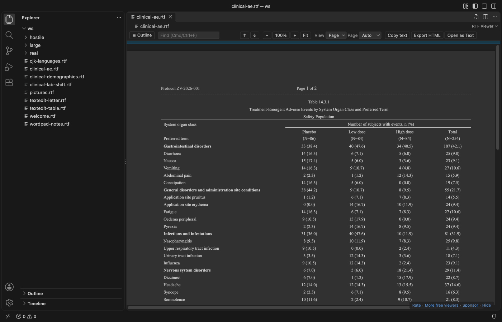
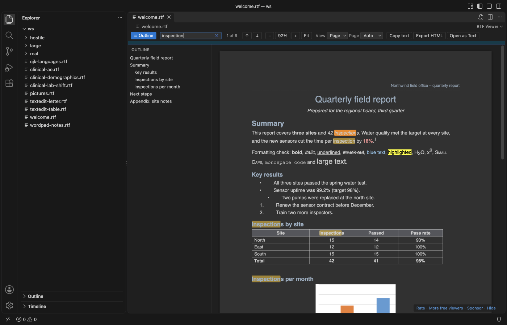
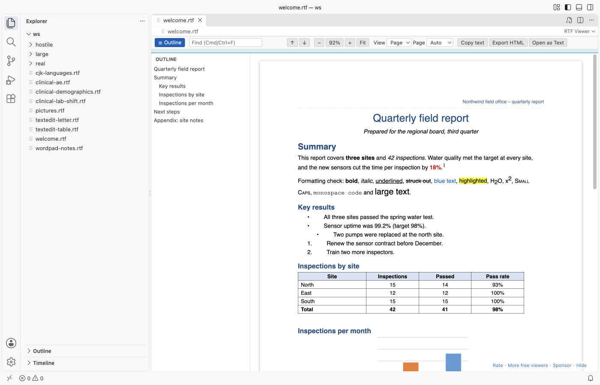

# RTF Viewer & Rich Text Viewer for VS Code

Open `.rtf` files in VS Code as a read-only page: fonts, colors, tables, pictures, headers and footers, with search, an outline, zoom and dark mode. Free, no sign-in, works offline. It sends nothing anywhere.

## Why this one

- Tables look right: Merged cells (across and down), borders, shading, header rows and wide pages. Tables from R, SAS, Word, LibreOffice and TextEdit all open, including clinical tables (TFLs) with spanning headers and repeated page headers.
- It opens the file you have: Word, WordPad, TextEdit and LibreOffice files, code pages (`\ansicpg`, font charsets), Unicode, Japanese, Chinese, Korean, Cyrillic and Greek text. Pictures in PNG, JPEG, EMF, WMF and BMP are drawn; anything else shows as a labelled box, never a blank page or a crash.
- It stays safe and quiet: No account, no telemetry, no network. Embedded objects (`\object`, OLE packages) are never opened or extracted. Links open only after a click, only for web and mail addresses, and VS Code asks first. `javascript:` and `file:` links do nothing.

## Features

Reading:

- Page view with the paper width and margins of the document, or Flow view that follows the editor width.
- Page colors: Auto (follows your VS Code theme), Light, Dark and Invert.
- Headers and footers on every page, with page numbers, and footnotes at the end.

Finding things:

- Search with Ctrl+F or Cmd+F. Enter and Shift+Enter move between matches.
- Outline of the headings; click one to jump. Zoom with Ctrl+= and Ctrl+-, or Fit to width.

Working with the file:

- Live reload: when R, SAS or another tool writes the file again, the view updates and keeps your place.
- Copy all text, or export one HTML file with the pictures inside.
- Open as Text shows the RTF source, and a button in the text editor brings you back.

## Large files

The file is read in a background thread, so VS Code stays responsive. The first part of the document shows while the rest is still being read, with a progress line. In our test, a 52 MB RTF with 100 pictures showed its first page in about a second, and a 400-page document opened in under 2 seconds (see CHANGELOG for the measured numbers). Files over 200 MB ask first (`rtfViewer.maxFileSizeMB`). Pictures over 20 MB become a labelled box (`rtfViewer.maxImageSizeMB`).

## Settings

| Setting | Default | What it does |
|---|---|---|
| `rtfViewer.theme` | `auto` | Page colors: `auto`, `light`, `dark`, `invert` |
| `rtfViewer.view` | `page` | `page` or `flow` |
| `rtfViewer.zoom` | `1` | 0.3 to 4 |
| `rtfViewer.maxFileSizeMB` | `200` | Larger files ask before they open |
| `rtfViewer.maxImageSizeMB` | `20` | Larger pictures become a box |
| `rtfViewer.liveReload` | `true` | Reload when the file changes on disk |
| `rtfViewer.askForRating` | `true` | One rating question after real use, at most twice, never after an error |
| `rtfViewer.showSupportLinks` | `true` | The small Sponsor and More free viewers links |

## Known limits

- Floating text boxes and drawing shapes are shown only through the fallback that Word stores with them.
- Nested tables are shown inside their cell in a simple form.
- Mac PICT and OS/2 pictures cannot be drawn by a browser and show as a box.
- `.rtfd` packages from TextEdit keep their pictures in the folder; open the `TXT.rtf` inside to see the text.

## Privacy

The viewer has no network access: the webview's content security policy blocks every request, and the extension makes none. Settings and the rating state stay in VS Code.

## Support Zovo

Zovo extensions are free, with no ads and no tracking. They are made by [theluckystrike](https://github.com/theluckystrike) on GitHub. If this one saves you time, you can support the work:

- [Sponsor on GitHub](https://github.com/sponsors/theluckystrike)
- [Follow theluckystrike on GitHub](https://github.com/theluckystrike)

## More tools by Zovo

- [DOCX Viewer, Word Viewer & DOCX Preview (Dark Mode)](https://marketplace.visualstudio.com/items?itemName=zovo.docx-viewer-vscode) previews Word and ODT files with dark mode, an outline and search.
- [PDF Viewer & PDF Reader](https://marketplace.visualstudio.com/items?itemName=zovo.pdf-viewer-dark) reads PDFs with a real dark mode, search, an outline and thumbnails.
- [EPUB Viewer, EPUB Reader & Ebook Reader](https://marketplace.visualstudio.com/items?itemName=zovo.zovo-epub-reader) reads EPUB books with a table of contents, search and light, sepia or dark themes.
- [EML Viewer, Email Headers & MBOX Viewer](https://marketplace.visualstudio.com/items?itemName=zovo.eml-viewer) reads EML, EMLX and MBOX email files with remote images blocked.
- [PPTX Viewer & PPT Viewer, PowerPoint Viewer & Slideshow](https://marketplace.visualstudio.com/items?itemName=zovo.pptx-slide-viewer) shows PowerPoint slides, thumbnails and speaker notes.

See [all Zovo extensions on the Marketplace](https://marketplace.visualstudio.com/publishers/zovo).

## License

MIT. Third-party code is listed in THIRD-PARTY-NOTICES.md.

## More from zovo

- [All free zovo VS Code extensions](https://marketplace.visualstudio.com/publishers/zovo) — file viewers, database clients, formatters. Offline, no telemetry, no sign-up.
- [Full MCP server catalogue](https://theluckystrike.github.io/mcp/) — local-first MCP servers for back-office work: invoices, VAT, PDFs, spreadsheets, payroll.
- [Hosted no-install MCP endpoints](https://mcp.zovo.one) — paste a URL in Claude / Cursor, nothing to install.
